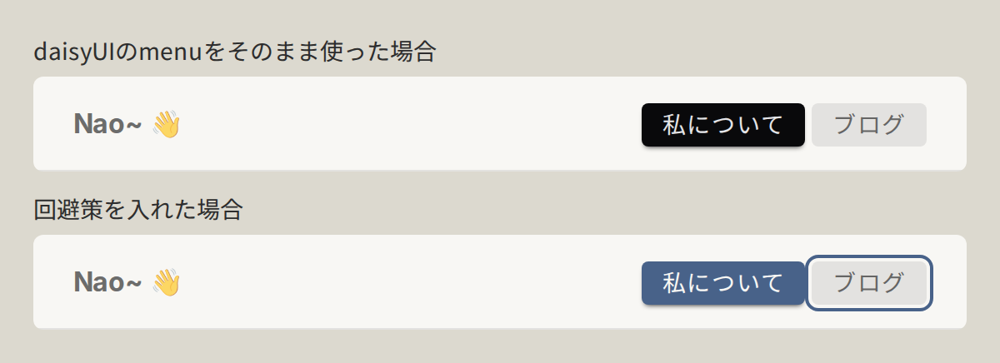
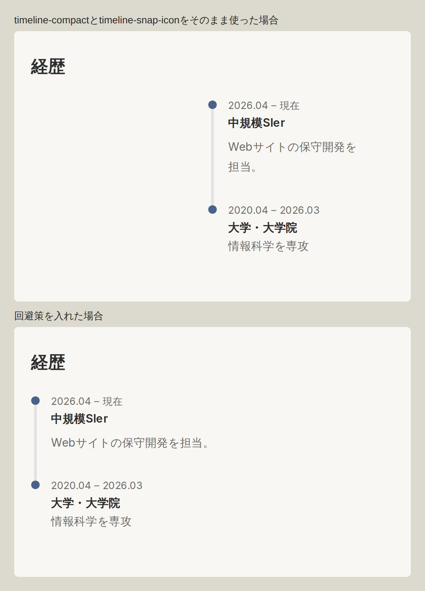

このサイトは[Tailwind](https://tailwindcss.com/)と[daisyUI](https://daisyui.com/)でスタイルを書いていたが、どちらも外して素のCSSに移行した。

daisyUIのコンポーネントを少し違う見た目で使うための回避策が増えてきたのが理由だ。Tailwindでも、クラスを重ねて見た目を上書きしていけば同じことが起こりうる。そのため、まとめて外した。

## 溜まっていた回避策

AIに見た目の要望を伝えて直してもらううちに、次のような回避策が入っていった。

### ヘッダーのナビ

daisyUIの `menu` はフォーカス時の枠（outline）を消しているので、キーボードでフォーカスしても枠が出ない。アクティブな項目の背景もテーマのneutral色（このサイトでは黒）になり、サイトの配色から浮いてしまう。



そこで、消された枠を出し直す指定を足していた。また、`aria-current` を付けると、`menu-active` を付けなくてもdaisyUIがアクティブの背景を黒くするので、`bg-primary` で上書きしていた。

```astro
<a
  href={href}
  class:list={[
    // daisyUIのmenuはfocus-visible時にoutlineを消すため、スタイルを明示して出し直す
    "focus-visible:outline-solid focus-visible:outline-2 focus-visible:outline-offset-2 focus-visible:outline-primary",
    // menu-activeは背景が黒になり文字色と衝突するため使わない
    active
      ? "bg-primary text-primary-content"
      : "text-base-content/70 hover:text-base-content",
  ]}
  aria-current={active ? "page" : undefined}
>
```

### 経歴のタイムライン

狭い画面でも窮屈にならないよう、`timeline-compact` で項目を片側にまとめ、`timeline-snap-icon` で丸印を各項目の1行目に揃えたかった。ところが2つを組み合わせると、左の列が残って項目が右に寄ってしまう。



左の列の幅は `--timeline-col-start` という変数で決まる。`timeline-compact` はこれを0にするが、`timeline-snap-icon` も同じ変数を `minmax(0, 1fr)` に設定している。2つの指定は詳細度が同じで、`timeline-snap-icon` の方が後に定義されているため、こちらが勝つ。そこで各項目に `[--timeline-col-start:0]`（Tailwindで任意のCSS変数を指定する記法）を付けて、0に戻していた。

```astro
<ul class="timeline timeline-vertical timeline-compact timeline-snap-icon">
  {careers.map((career) => (
    // snap-iconの--timeline-col-startがcompactの指定を上書きして左列が残るため、0に戻す
    <li class="[--timeline-col-start:0]">
      <hr class="bg-base-content/10" />
      <div class="timeline-middle">
        <span class="block size-3 rounded-full bg-primary" />
      </div>
      <div class="timeline-end ms-4 mb-8">...</div>
      <hr class="bg-base-content/10" />
    </li>
  ))}
</ul>
```

どちらも、なぜそうなるかはdaisyUIのソースを読まないとわからない。

## 素のCSSにした後

移行した時点のナビは次のとおりだ。

```astro
<a href={href} aria-current={active ? "page" : undefined}>{label}</a>

<style>
  nav a {
    color: var(--color-muted);

    &:focus-visible {
      outline: 2px solid var(--color-primary);
      outline-offset: 2px;
    }

    &[aria-current="page"] {
      background-color: var(--color-primary);
      color: var(--color-primary-content);
    }
  }
</style>
```

打ち消す相手がないので、フォーカスの枠もアクティブの色も書いたとおりに出る。

タイムラインはdaisyUIの `timeline` を使わずにグリッドで組み直した。左の列に丸印と線、右の列に本文を置くだけなので、左の列を消す指定はもう要らない。

```astro
<li>
  <hr class="line-before" />
  <span class="dot" />
  <div class="body">...</div>
  <hr class="line-after" />
</li>

<style>
  /* 1列目に丸印と線、2列目に本文。行は「丸印の上の余白・丸印・残り」の3段 */
  li {
    display: grid;
    grid-template-columns: auto minmax(0, 1fr);
    grid-template-rows: 0.5rem auto minmax(0, 1fr);
  }

  .dot {
    grid-area: 2 / 1;
  }

  .line-before {
    grid-area: 1 / 1;
  }

  .line-after {
    grid-area: 3 / 1;
  }

  .body {
    grid-area: 1 / 2 / 4 / 3;
  }
</style>
```

行数は増えたが、打ち消す指定がなくなり、書いてあることがそのまま見た目になる。

TailwindとdaisyUIのままでも、もっと素直に書く方法はあったのかもしれない。ただ、AIは要望に応えるために回避策を足していき、そうして溜まった複雑さには自分では気づきにくい。AIにコードを書いてもらうなら、素のCSSの方が合っているのかもしれない。
